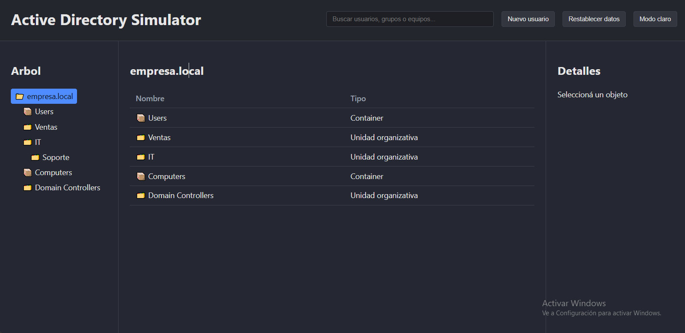

# AD Simulator

Simulador de Active Directory hecho con HTML, CSS y JavaScript (módulos ES, sin librerías).
Recrea la consola "Usuarios y equipos de Active Directory" para practicar tareas de soporte técnico.

**Demo en vivo:** https://tobiascastaneda2000.github.io/active-directory-JS/

## Qué permite hacer
- Navegar el dominio: árbol de containers y OUs anidadas.
- Buscar usuarios, grupos y equipos por nombre o usuario, sin importar las tildes.
- Ver las propiedades de un usuario y ejecutar acciones de soporte: habilitar, deshabilitar,
  desbloquear y restablecer contraseña (con política de complejidad).
- Crear usuarios con validaciones: usuario único, formato y contraseña.
- Administrar los grupos de un usuario y ver los miembros de cada grupo.
- Mover usuarios, equipos y grupos entre carpetas.
- Los cambios se guardan en el navegador y hay un botón para volver a los datos de ejemplo.
- Tema claro y oscuro, y navegación con teclado.

Es una simulación educativa: no se guardan contraseñas y no se conecta a ningún servidor.

## Equivalencia en un AD real (PowerShell)

| Acción en el simulador | Comando real |
|---|---|
| Desbloquear cuenta | `Unlock-ADAccount -Identity jperez` |
| Deshabilitar cuenta | `Disable-ADAccount -Identity jperez` |
| Habilitar cuenta | `Enable-ADAccount -Identity jperez` |
| Restablecer contraseña | `Set-ADAccountPassword -Identity jperez -Reset` |
| Pedir cambio al iniciar sesión | `Set-ADUser -Identity jperez -ChangePasswordAtLogon $true` |
| Crear usuario | `New-ADUser -Name "Juan Pérez" -SamAccountName jperez` |
| Agregar a un grupo | `Add-ADGroupMember -Identity "Ventas-Todos" -Members jperez` |
| Mover a otra OU | `Move-ADObject -Identity "<DN del objeto>" -TargetPath "<DN de la OU destino>"` |
| Ver un usuario | `Get-ADUser -Identity jperez -Properties *` |

## Decisiones de diseño
- **Lista plana con `parentId`**: así funciona la jerarquía de AD, y mover un objeto es cambiar un solo dato.
- **Árbol recursivo**: una función que se llama a sí misma dibuja cualquier nivel de OUs.
- **Separación de responsabilidades**: los datos, las reglas y el dibujo viven en archivos distintos.
- **Botones nativos** para todo lo clickeable, para que funcione con teclado y lectores de pantalla.

## Estructura
- `js/data.js`: datos iniciales del dominio.
- `js/state.js`: reglas y acciones (no toca el DOM).
- `js/ui.js`: todo lo que se dibuja en pantalla.
- `js/storage.js`: guardado en `localStorage`.
- `js/tema.js`: tema claro y oscuro.
- `js/main.js`: conecta todo.

## Cómo correrlo
Abrir la carpeta en VS Code y usar la extensión Live Server sobre `index.html`.

## Próximos pasos
Registro de actividad, pruebas automáticas de `state.js` y exportar o importar los datos en JSON.